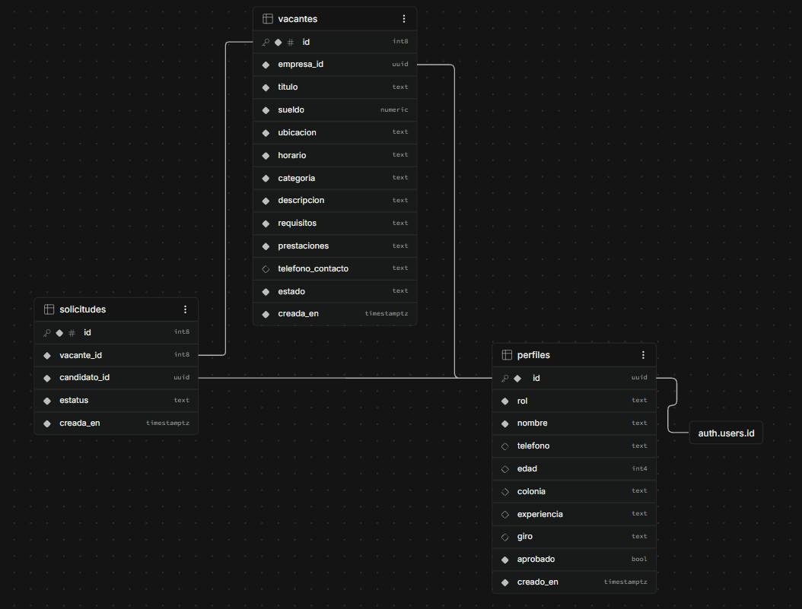

Cuentas de prueba:
Cuenta candidato aprobado: patricio.fonseca@udem.edu
Contraseña: UDEM-AMARILLO
Cuenta candidato no aprobado: patriciofonseca@formus.edu.mx
Contraseña: UDEM-AMARILLO
Cuenta empresa: patofonramirez@gmail.com
Contraseña: UDEM-AMARILLO

Integrante: Patricio Fonseca Ramírez: Hizo todo el sitio web

Tecnologías usadas: Vercel, github, supabase, vite, CSS, javascript, visual studio code, git bash, entre otros.
Como correr el proyecto locamente: descargar el repositorio de github amac-react y extraer la carpeta, luego, abrir git bash o una terminal dentro de la carpeta del proyecto, escribir el comando cd amac-react, instalar las dependencias, npm install, crear archivo .env.local en raíz del proyecto con variables vite supabase url y vite supabase publishable key, y por último, en git bash escribir, npm run dev para iniciar servidor local

Diagrama de base de datos

El proyecto utiliza supabase con postgresql
Las tablas principales son: perfiles, vacantes, solicitudes
La seguridad de los datos se administra mediante políticas RLS

Tabla RF y estados

RF Estado

001 Completo

002 Completo

003 Completo

004 Completo

005 Completo

006 Completo

007 Completo

008 Completo

009 Completo

010 Completo

011 Completo

012 Completo

013 Completo

015 Completo

019 Completo

020 Completo

021 Completo

022 Completo

024 Completo

051 Completo

054 Completo

Extra: 029 Completo

Políticas de seguridad RLS
La base de datos utiliza Row Level Security (RLS) para controlar qué información puede consultar o modificar cada usuario, dependiendo de su rol y de su relación con los registros.
Tabla perfiles
Cada quien ve su perfil (SELECT): permite que cada usuario consulte su propia información.
Todos ven los perfiles de empresas (SELECT): permite consultar los perfiles registrados con rol de empresa.
La empresa ve a quien aplicó a sus vacantes (SELECT): permite que las empresas consulten los perfiles de los candidatos que se postularon a sus vacantes.
Cada quien edita su perfil (UPDATE): permite modificar la información del propio perfil, sin cambiar el rol ni el estado de aprobación.

Tabla vacantes
Ver vacantes activas o las propias (SELECT): permite consultar las vacantes activas y las publicadas por la propia empresa.
El candidato sigue viendo las vacantes a las que aplicó (SELECT): permite que el candidato consulte las vacantes a las que ya se postuló, aunque estén pausadas.
Solo empresas publican, a su nombre (INSERT): permite que únicamente las empresas registradas publiquen vacantes asociadas a su cuenta.
La empresa edita sus vacantes (UPDATE): permite que cada empresa modifique únicamente sus propias vacantes.

Tabla solicitudes
Candidato ve las suyas; empresa ve las de sus vacantes (SELECT): permite que los candidatos consulten sus postulaciones y que las empresas consulten las solicitudes recibidas.
Solo candidatos aprobados se postulan (INSERT): permite crear solicitudes únicamente a candidatos aprobados y autenticados.
Candidato cancela si no está resuelta (UPDATE): permite cancelar solicitudes que estén enviadas o en revisión.
Empresa cambia el estatus (UPDATE): permite que la empresa responsable actualice el estado de las solicitudes a En revisión, Aceptada o Rechazada.
